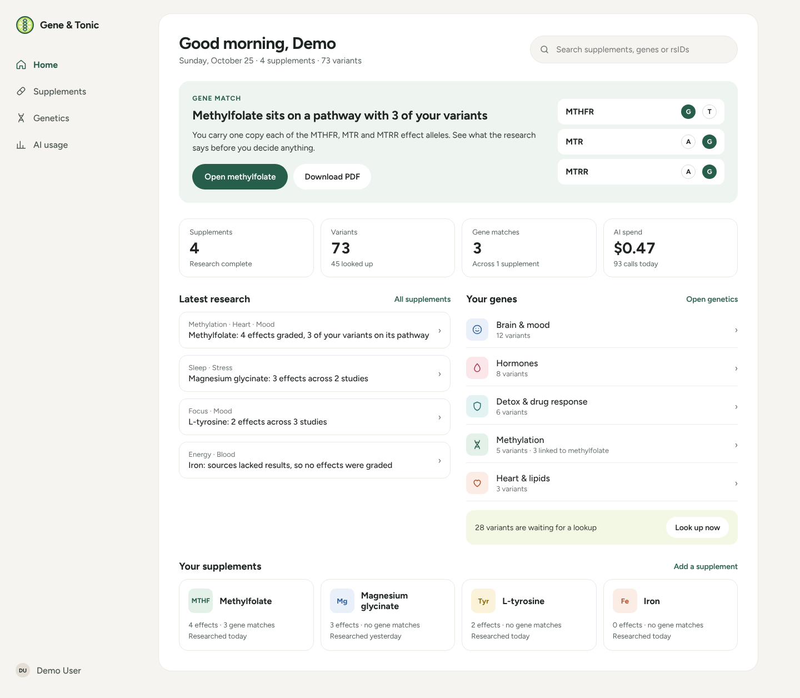
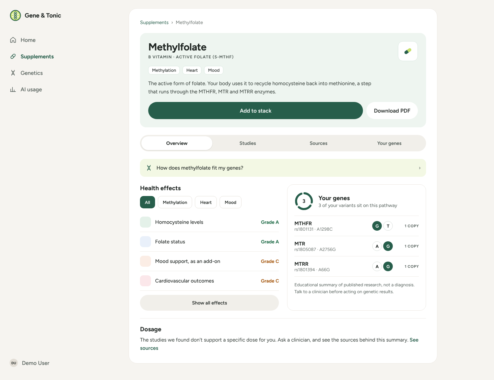
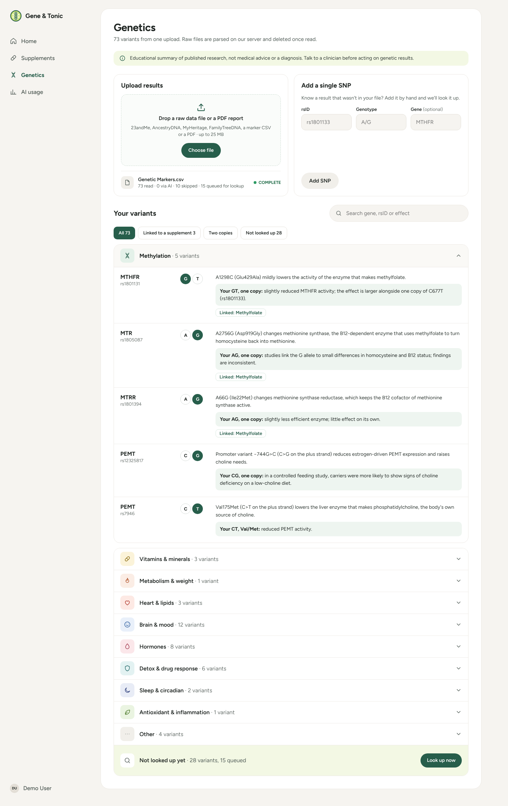
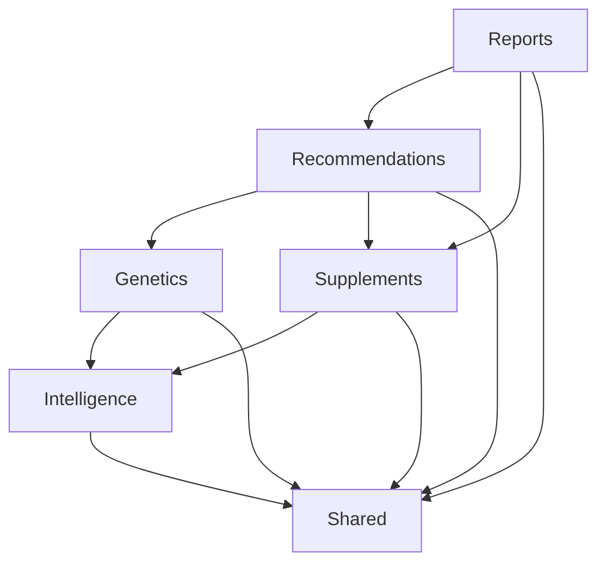

# Gene & Tonic

**Supplement research cross-referenced with your own genetics, delivered as a PDF report.**

> [!IMPORTANT]
> **This is a rapid prototype.** It was built in about 1–2 days (October 24–25, 2026) as a proof of concept for a job interview. It is meant to show architecture, code quality and product thinking under a tight deadline. It is not a hardened production system. Scope was cut where needed and quality was not; the [known gaps](#known-gaps-and-next-steps) are listed below.

> [!WARNING]
> Not medical advice. Research summaries are generated by an AI model from public sources and may be incomplete or wrong.



---

## What it does

1. **Research a supplement.** Add a supplement (e.g. *methylfolate*) and a queued job searches trusted sources (PubMed, PMC, NIH ODS, Cochrane, NCCIH) through Firecrawl, followed by a second, gene-focused search. An AI model turns the scraped sources into structured findings: proven effects with evidence grades (`strong` / `moderate` / `limited`), mechanisms of action, key studies, and **gene interactions** (gene, rsID, effect allele, and whether the variant means the supplement `helps`, needs `caution`, or is `related`). Every claim cites its sources. Progress shows live: `queued → searching → analyzing → complete`.
2. **Upload your genetics.** Upload a raw export (23andMe, AncestryDNA, MyHeritage/FTDNA), a marker CSV, or a lab-report PDF. Raw exports are parsed locally. Genotypes are stored encrypted, and variants are grouped (methylation, vitamins and minerals, heart and lipids, brain and mood, …). Unknown SNPs are looked up against SNPedia, NCBI and EBI.
3. **See what's relevant to you.** On every supplement page a **rule-based** matcher compares the supplement's gene interactions with your genotypes (rsID plus allele, then rsID, then gene) and shows which of your variants matter and why.
4. **Download the PDF report.** One click renders a multi-page report (overview, effects, your genetics, mechanisms, studies, numbered sources) in one of two templates.
5. **Track AI spend.** Every provider call is logged with tokens, Firecrawl credits, latency and estimated cost, shown on the AI usage page over 24 h, 7 days or all time.

| Supplement detail | Genetics |
|---|---|
|  |  |

<sub>Screens are the approved design mocks the UI was built from (`docs/design/gene-and-tonic/`).</sub>

## Stack

Laravel 13 · PHP 8.4 · Livewire 4 (single-file components) · Flux UI · Tailwind 4 · MySQL 8.4 · Pest · PHPStan level 7 · [nwidart/laravel-modules](https://github.com/nWidart/laravel-modules) · [spatie/laravel-pdf](https://github.com/spatie/laravel-pdf) v2 (Chrome driver) · [laravel/ai](https://github.com/laravel/ai) · Firecrawl (REST)

---

## Architecture: a modular monolith

All domain code lives in `Modules/<Name>/`, built with **nwidart/laravel-modules**. The root `app/` is only the application shell: the `User` model, providers, and one shared layout. Modules supply content, not chrome.



| Module | Owns | May depend on |
|---|---|---|
| **Shared** | The kernel: DTO helpers and the `PageActions` slot registry. Kept deliberately tiny. | nothing |
| **Intelligence** | The provider-agnostic AI gateway (`TextGenerator`, `WebResearcher`), named model profiles, prompt templates, and request and cost logging. It has no domain knowledge. | Shared |
| **Genetics** | Uploads, parsers, the gene reference table, and encrypted per-user variants. All raw genetic data stays here. | Intelligence, Shared |
| **Supplements** | The catalog and the AI research pipeline: effects, mechanisms, studies, sources and gene interactions. | Intelligence, Shared |
| **Recommendations** | Rule-based matching of a user's genetic profile against supplement gene interactions. | Genetics, Supplements, Shared |
| **Reports** | PDF rendering, templates and download. A read-only consumer. | Supplements, Recommendations, Shared |

### Boundary rules

- **Public vs. private.** A module's public API is its `Contracts`, `Data` (DTOs), `Events`, `Enums`, `Exceptions` and `Testing` namespaces. `Models`, `Actions`, `Services`, `Livewire` and the rest are private.
- **Cross-module reads go through contracts** bound in the owning module's service provider, e.g. `GeneticProfileReader`, `SupplementResearchReader`, `GeneticRelevanceReader`. They return `final readonly` DTOs, never Eloquent models.
- **No cross-module joins, relationships, writes or foreign keys.** A module touches only its own tables. The only foreign keys point at `users`.
- **Owning modules ship in-memory fakes** of their contracts under `Testing/`, so other modules' tests never mock someone else's internals.
- **Enforced by tests.** Each dependent module has a Pest architecture test (`tests/Unit/BoundaryTest.php`) that fails on any import of another module's private namespaces.

### Modules extending each other's pages without importing each other

The supplement page belongs to Supplements, but the PDF download button comes from Reports, and the "your genes" panel comes from Recommendations. Supplements doesn't know either of them exists. They plug in through `Shared\Contracts\PageActions`, a named-slot registry:

```php
// Modules/Reports/app/Providers/ReportsServiceProvider.php
app(PageActions::class)->register('supplement.header', 'reports::components.download-menu');

// Modules/Recommendations/app/Providers/RecommendationsServiceProvider.php
app(PageActions::class)->register('supplement.panels', 'recommendations::slots.genetic-panel');
```

The owning page renders whatever is registered under each slot, so dependencies keep pointing in one direction.

### A customized module generator

`php artisan module:make` produces modules that already follow these rules:

- `config/modules.php` turns off nwidart's per-module `package.json`, `vite.config.js`, Sass, master layout and API routes. All modules share one Vite, Tailwind and Flux build.
- `stubs/nwidart-stubs/` overrides only the stubs that matter. The service provider registers the module's Livewire namespace (`genetics::upload-results`), the route provider maps web routes only, and generated tests are Pest.

---

## Entities

Tables are grouped by the module that owns them. **Recommendations and Reports own no tables.** They are pure readers that compose other modules' DTOs.

| Module | Table | What it holds |
|---|---|---|
| Genetics | `gene_variants` | Reference data per rsID: gene, plus-strand reference and risk alleles, common name (e.g. MTHFR *C677T*), category and broad group, and plain-language effect. Seeded, and extended by AI lookups. |
| | `user_variants` | One row per user per rsID, with the **genotype encrypted** and the source (upload or manual). |
| | `genetic_uploads` | Upload status, parse method (`local`, `local_ai`, `ai`), and read, AI-extracted and skipped counts. The raw file is deleted after processing. |
| Supplements | `supplements` | Catalog entries. |
| | `supplement_researches` | One research run per supplement: status, summary, kicker, topic tags, and when genetics were checked. |
| | `supplement_effects`, `supplement_mechanisms`, `supplement_studies` | Structured findings with evidence grades and citations. |
| | `supplement_sources` | Cited URLs (URL and PMID validated) with scraped excerpts. |
| | `supplement_gene_interactions` | Gene, rsID, effect allele, relation (`helps`, `caution`, `related`) and explanation, all source-cited. |
| Intelligence | `ai_requests` | Every provider call: operation, profile, provider and model, effort, tokens, credits, latency, estimated USD cost, status and error. Genotypes are never logged. |

---

## PDF generation

Reports render with **spatie/laravel-pdf v2 using the Chrome driver**. chrome-php drives a local Chrome or Chromium binary directly, so there's no Node or Puppeteer in the stack, and report views can use modern CSS.

- **DTOs in, PDF out.** `SupplementReportRenderer` receives a `SupplementResearchData` and an optional `GeneticRelevanceData`. Views never see models or query the database.
- **Templates are configuration.** There are two templates: `clinical` (A4) and `modern` (US Letter). Each is a config entry (format, margins, orientation) plus a view folder with its own layout, header, footer and styles. Users switch templates from the download menu.
- **Per-section overrides.** The layout loops over the sections `overview`, `effects`, `genetics`, `mechanisms`, `studies` and `sources`, and resolves each one with `@includeFirst([template-specific, shared])`. A template restyles one section by adding one file.
- **Citations are numbered** by position in the source list and stay consistent across sections.
- **Privacy.** The PDF route is public, but the genetics section renders only for the signed-in owner. The route is rate-limited.
- **Tests** call `Pdf::fake()` and assert on the response, so the normal suite never launches Chrome. An opt-in test renders every template for real:

```bash
RUN_CHROME_TESTS=1 REPORTS_PDF_OUTPUT_DIR=/tmp/pdfs vendor/bin/pest Modules/Reports/tests/Feature/ChromeRenderTest.php
```

To add a template, add a config entry and a view folder. No code changes are needed (see `CLAUDE.md` → *Adding a report template*).

---

## Key decisions

| Decision | Why |
|---|---|
| **Modular monolith instead of microservices or a flat app** | Gives clear ownership and enforceable boundaries without operating distributed infrastructure. Each module could later be extracted along its contracts. |
| **nwidart/laravel-modules** | Mature, and its generator is fully customizable through stubs. The upfront research (`reports/Laravel modular monolith practices.md`) leaned toward internachi/modular. The boundary rules apply either way. |
| **One AI gateway (Intelligence) behind contracts** | Only Intelligence talks to a provider. It wraps `laravel/ai`, and every call goes through a **named profile** (`supplements.research`, `genetics.extract`, `genetics.lookup`, `genetics.group`) with its own provider, model, effort, token cap, timeout and Blade prompt, all configurable via `.env`. Calls are logged and costed centrally. |
| **Firecrawl over plain REST, no SDK** | It's one endpoint. `Http` keeps the dependency count down and works with `Http::fake()` and `preventStrayRequests()`. |
| **Search restricted to trusted domains** | Research cites PubMed, PMC, NIH and Cochrane, not SEO blogs. URLs and PMIDs are validated before they are persisted and again when rendered. |
| **Structured output with a JSON schema** | Model output is parsed into typed findings. Unusable output fails the run cleanly instead of storing garbage, and claims citing only unsafe sources are dropped. |
| **Rule-based recommendations, not AI** | Matching a genotype against a known interaction is deterministic. Rules are free, instant, testable and explainable. The AI's job is research, not judgment about a person's data. |
| **Local-first genetics parsing** | Raw vendor exports never leave the server. The model sees data only when the local parser can't read it: for PDFs or unknown formats it gets marker lines only, never whole documents, and for marker CSVs only the rsID, gene, genotype and marker-name cells, never notes. |
| **Cheap models by default for genetics** | Extraction, lookup and grouping are small, structured tasks that run on the low-cost model tier at low effort. Research gets a stronger model. |
| **No surprise AI spend** | Lookups are capped per upload, and the rest wait for an explicit "Look up now". Actions are rate-limited. New model-filled fields appear on the next manual re-run instead of through an automatic backfill. Stale runs are reaped by a scheduled command. |
| **Queued, idempotent jobs** | Research and uploads run on the queue. Starting a run claims it atomically, so a double click dispatches one job. Retries don't overlap. |
| **Filtering genetics in memory** | Genotypes are encrypted, so SQL can't filter on them, and a profile is tens of rows. Grouping, filtering and search run on the loaded list. |

---

## Privacy and genetic data

- Raw uploads go to a **private disk** (no public URL) and are deleted after processing. The upload limit is 25 MB.
- Genotypes are stored with **encrypted casts** and never logged.
- Other modules, including AI calls, receive only the summarized `GeneticProfile` DTO.
- Every Genetics and Recommendations query is scoped to `auth()->id()`.
- The tests run with `Http::preventStrayRequests()` and the Intelligence fakes, so they never call a real API.

---

## Running it locally

**Requirements:** PHP 8.4, Composer, Node, MySQL 8.4, Google Chrome or Chromium (for PDFs), an OpenAI API key, and a Firecrawl API key.

```bash
composer setup                    # install, .env, key, migrate, npm build
# set DB_*, OPENAI_API_KEY and FIRECRAWL_API_KEY in .env
php artisan db:seed               # demo user + gene reference data
composer run dev                  # server, queue worker, logs and Vite
php artisan schedule:work         # separate terminal: reaps stale research and upload runs
php artisan genetics:demo-files   # writes a synthetic 23andMe file and report PDF to storage/app/demo/
```

Sign in with the demo user (`demo@example.com` / `password` by default, configurable via `DEMO_USER_*`). Then add *methylfolate*, upload the demo file on the Genetics page, open the supplement, and download the PDF. Uploads up to 25 MB need PHP's `upload_max_filesize` and `post_max_size` raised to match. All tunables (models, effort, timeouts, caps, domains) are listed in `.env.example`.

### Quality checks

```bash
composer test                     # Pint (style), PHPStan level 7, then the full Pest suite
vendor/bin/pest --testsuite=Modules
vendor/bin/pest Modules/Genetics/tests
```

Tests run on in-memory SQLite and bind the Intelligence fakes, so no API keys are needed.

---

## Known gaps and next steps

This was a two-day build, and these are the things I'd do next:

- **Deptrac** for the dependency graph and cycle detection. Today the boundaries are enforced per module by Pest arch tests, and Shared has no boundary test of its own.
- **Events are designed but not yet used.** The rules call for `ShouldDispatchAfterCommit` events for cross-module side effects. Every flow so far is a synchronous read, so none were needed.
- **Auth is a minimal hand-rolled login** with a seeded demo user. There's no registration, password reset or multi-tenant hardening.
- **Reports render on request** rather than being generated in the background and stored.
- **AI usage rows don't record a subject**, such as which supplement a call was for.
- **Production concerns are out of scope:** deployment, a Chrome sandbox in CI (`LARAVEL_PDF_CHROME_NO_SANDBOX`), observability, and provider failover.

---

## How it was built

The project was built feature by feature, with a written plan for each: requirements, recorded decisions, a task breakdown, review, and a completion record. They live in [`docs/sdlc/plans/`](docs/sdlc/plans). The visual redesign spec, tokens, brand assets and mocks are in [`docs/design/gene-and-tonic/`](docs/design/gene-and-tonic). Contributor-level conventions (generators, boundary rules, domain constraints) are in [`CLAUDE.md`](CLAUDE.md).
